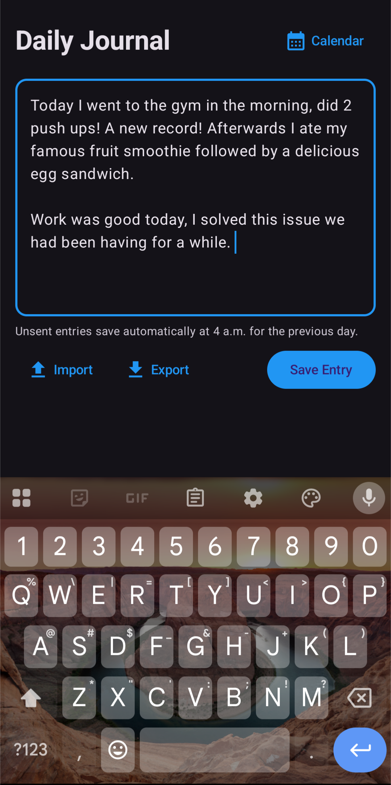
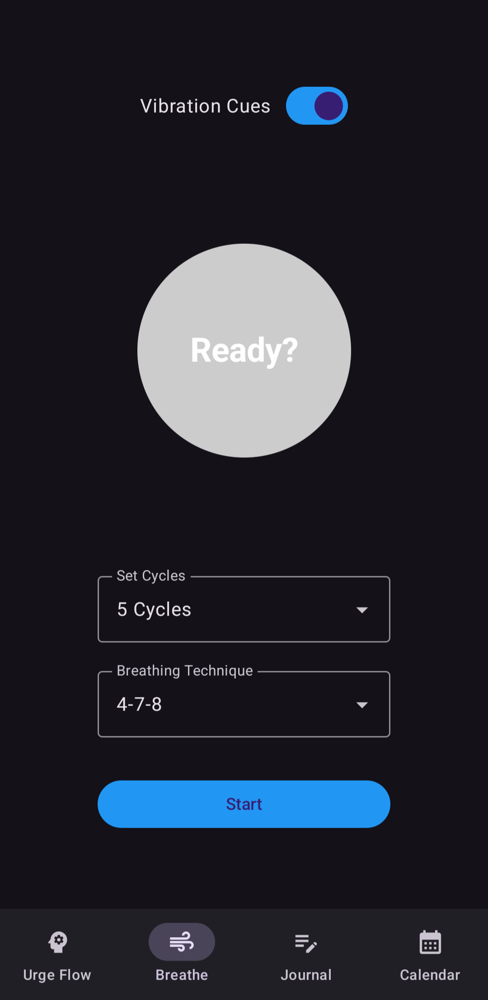
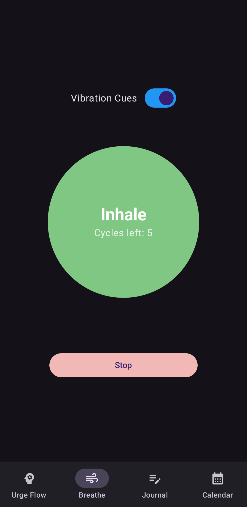
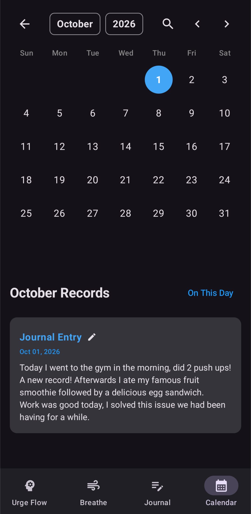
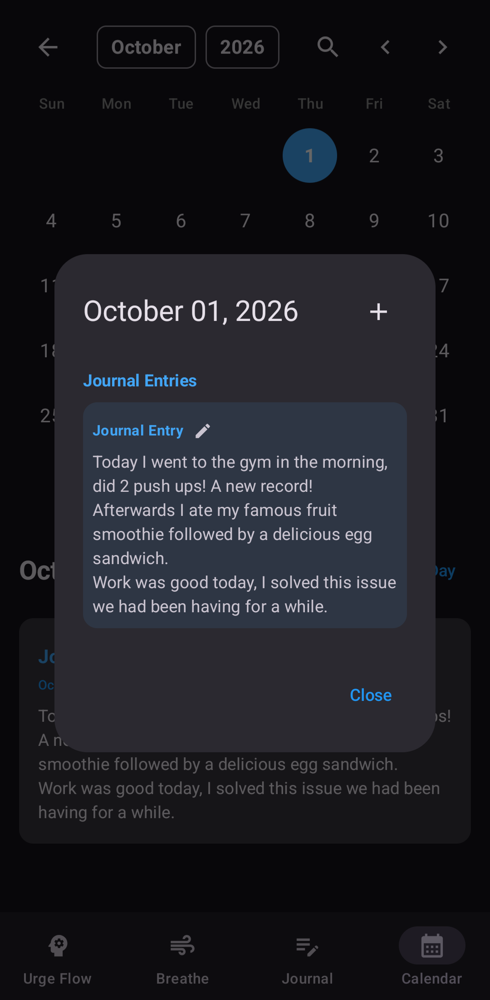
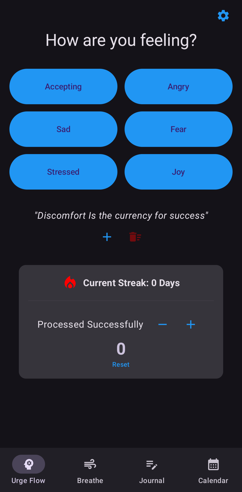
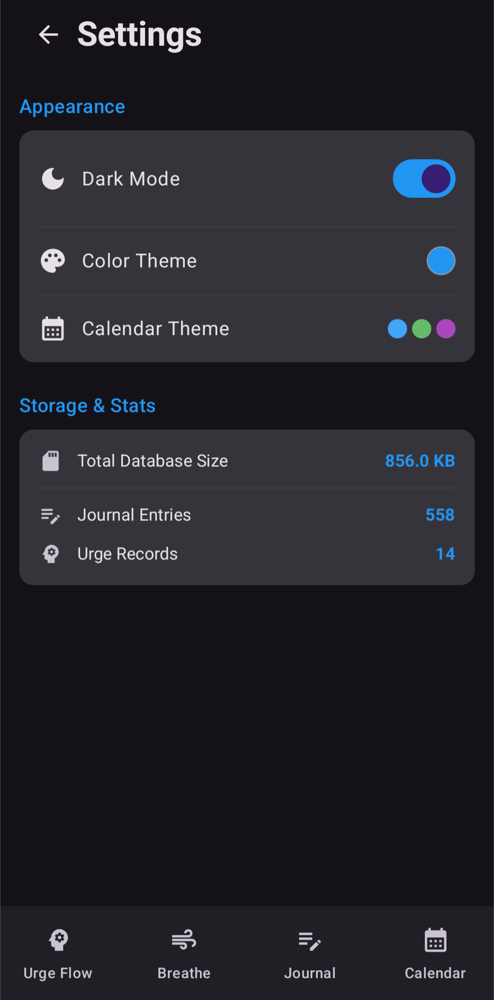

# Reset

An Android app for guided urge reflection, breathing exercises, and daily journaling. Built with Kotlin, Jetpack Compose, Material 3, and Room. Supports Android 8.0 (API 26) and later; compiles and targets API 35.

## Build and test

1. Install Android Studio or an Android SDK with platform 35 and build-tools 36.0.0.
2. Use JDK 21 for Gradle. The checked-in daemon toolchain configuration requests Java 21; the wrapper uses Gradle 9.6.0.
3. Set `ANDROID_HOME` to your SDK path, or create an untracked `local.properties` containing `sdk.dir=/absolute/path/to/Android/Sdk`.
4. Run:

```sh
./gradlew testDebugUnitTest assembleDebug assembleDebugAndroidTest lintDebug
```

The first build needs network access for dependencies. Subsequent builds can use `--offline` once dependencies are cached. The debug APK is `app/build/outputs/apk/debug/app-debug.apk`. Unit-test and lint reports are under `app/build/reports/`.

With a test device or emulator attached:

```sh
./gradlew connectedDebugAndroidTest
```

This runs the database safety tests as well as the generated application-context test. Database safety tests create isolated temporary databases, not the user's `urge_db`.

The GitHub Actions workflow builds both APKs, runs JVM tests, and runs lint on pushes and pull requests once this repository is hosted on GitHub. It compiles, but does not execute, device tests. No remote is currently required for local development.

## Local emulator

The development machine has a Pixel 6 virtual device named `Reset_API_35`, using the Android 15 (API 35) Google APIs x86_64 image. It uses KVM hardware acceleration.

Start its desktop window from the project directory:

```sh
./scripts/start-emulator.sh
```

For automated testing without a window, add `-no-window`. The launcher uses the host GPU and disables Vulkan and snapshots: the bundled software renderer crashed during startup on this machine, while the host GPU configuration booted successfully. The SDK defaults to `$HOME/Android/Sdk`; set `ANDROID_HOME` if yours is elsewhere.

Once Android has booted, run:

```sh
./gradlew connectedDebugAndroidTest
```

The emulator runs the database and journal-rollover integration tests, including database upgrades, reopening, missing-migration preservation, transactional import rollback, backup restoration, and duplicate-safe draft submission. Reset also launched successfully with an empty crash log.

The device also appears in Android Studio's Device Manager. The script supplies the graphics workaround explicitly. Do not launch a second copy while this virtual device is already running.

## Code map

- `MainActivity.kt`: navigation and persisted appearance settings.
- `data/`: Room entities, DAO, database configuration, entry backup and import logic.
- `ui/screens/`: urge flow, breathing, journal, calendar, import, and settings.
- `ui/components/`: dialogs, daily quotes, journal editing, and export controls.
- `util/EntryDates.kt`: date boundaries, date-picker conversion, and streaks.
- `util/SearchUtils.kt`: search ranking and highlighted snippets.

Application Kotlin lives under `app/src/main/java/com/example/urgeprocessor/`.

## Entry dates

New journal and urge entries belong to the previous local calendar date before 4 a.m.; at 4 a.m. they belong to the current date. Streaks use the same cutoff. Entries explicitly added to a calendar date or imported from dated text retain that selected date.

Calendar day ranges advance by calendar dates, including 23-hour and 25-hour days. Material date-picker values are interpreted as UTC-encoded calendar dates and converted to local day boundaries for inclusive exports. Existing records are not rewritten.

The current database stores dates as epoch milliseconds, so changing the device's time zone can still change the date shown for historical records. A date-only schema migration would be a separate change.

## Voice recordings

Open **Journal → Record a moment** to capture audio, pause/resume, stop, preview, optionally title it, and save it. Each recording appears alongside journal entries in the calendar's month records and selected-day dialog, with its original capture date, time, time zone, duration, play/pause, seeking, and confirmed deletion. Recording titles are searchable, and recordings also appear in On This Day.

Tap the playback speed button to cycle through 1×, 1.5×, 2×, and 2.5× in calendar lists, day views, On This Day, and recording previews. Speed changes preserve voice pitch. The selection stays while pausing, resuming, and switching recordings in the same screen; reopening the player starts at 1×.

Microphone access is requested only when starting a recording. Recording and playback work offline. Audio is AAC in M4A files in the app's private storage; Room holds metadata separately, leaving room for future transcripts and trip links. Multiple recordings per day are supported.

Recordings use the existing 4 a.m. journal-day cutoff. Their assigned date, actual capture timestamp, and original time zone are stored separately, so changing time zones does not move them to another calendar day. Captures after midnight can show the previous journal day as well as their actual timestamp.

This version records while the app is visible. Leaving the app, locking the phone, or keeping the recording for later stops capture and preserves the unfinished audio for review. Unfinished recordings survive normal app reopening and configuration changes. An abrupt process kill during active capture can leave an unplayable file; the app reports that and allows discarding it. A save failure keeps playable audio for retry, and retrying cannot create duplicates.

Entry backups stream saved audio into a ZIP with a versioned `entries.json` manifest; they omit unfinished recordings. Restore validates the complete file list and audio checksums before adding records, regenerates local IDs, and removes newly copied audio if the database import fails. Older JSON backups and text imports remain supported. Text exports contain written entries only. Include a ZIP backup when transferring recordings to another phone.

## Speak to write

Open **Journal → Speak to write** to dictate a text-only journal draft. Tap **Start speaking**, speak a section, and stop or wait for the speech service to finish. **Speak more** adds another section. Review or edit the words, choose **Add to journal**, then use the existing **Save Entry** button. Spoken text appends to existing writing as a new paragraph. Saved entries work with the calendar, search, backups, and exports just like typed entries.

This feature uses Android speech recognition directly and never creates an audio file or a recording entry. On-device recognition is the default when Android 12+ and the phone's speech service support it. It never silently switches to online processing. **Use system speech** is an explicit alternative; that provider may process audio online under its own policies. Language packs, supported languages, punctuation, session length, and availability depend on the device's recognizer. This version transcribes speech; it does not use generative rewriting or filler-word cleanup.

Interim phrases replace their previous hypothesis instead of duplicating words. Captured text is kept on the device for review when dictation is interrupted, the screen closes, or recognition fails. **Keep for later** preserves a separate spoken draft; **Discard text** leaves existing journal writing intact. Adding the reviewed text moves it into the main draft in one preference commit, preventing duplicate appends after reopening. The normal journal date and 4 a.m. rollover rules apply when the text is added. Unfinished spoken drafts are not included in entry backups.

## Automatic journal submission

Unsent text in the main Daily Journal box is saved automatically when its journal day ends at 4 a.m. For example, a draft written Thursday evening or Friday at 2 a.m. becomes a Thursday journal entry at Friday's cutoff. The editor then clears for the new day. Blank drafts are ignored, and Save Entry still works normally.

The draft persists its original calendar date, time zone, and unique ID. Reopening several days later saves it to its original date, not yesterday's date. Existing calendar-day drafts are unaffected. Old main-editor drafts from before this feature had no date metadata; their text is preserved and assigned to the current journal day when first loaded after the upgrade.

While Reset is visible, it checks for rollover each second and immediately on resume. WorkManager schedules a background check for the draft's next 4 a.m. cutoff and persists that work across normal app closure and reboots. Android may defer background execution during power saving, and a force-stopped app cannot run until reopened. In those cases Reset catches up with the original date. See [Android's work scheduling guidance](https://developer.android.com/develop/background-work/background-tasks/persistent/getting-started/define-work).

Saving locks the editor briefly, inserts with the draft's unique ID, and clears the draft only after the database write succeeds. Retries after a crash cannot create another copy. If a write fails, the draft stays available. Calendar drafts, saved journal entries, and other preferences are left intact.

## Import, export, and entry backups

Open **Journal → Export**:

- **Save entry backup** writes a versioned ZIP file containing every saved recording (metadata and audio), journal, urge record (including emotion color and all answers), and quote. It preserves timestamps and text exactly. It does not include drafts, theme preferences, or counters.
- **Export text** writes a readable chronological report. It defaults to all dates; optionally choose an inclusive starting date. A text report is not a complete restorable backup.

Open **Journal → Import** to select a ZIP backup, an older JSON backup, or paste dated journal text. Imports append records, assign new local IDs, and do not overwrite existing records. Importing the same file more than once creates duplicates. All records are parsed before writing, and the write is transactional: a failed import leaves no partial additions.

Text input accepts a new entry header at the beginning of a line, using `MM-DD-YYYY:` or `MM/DD/YYYY:`. A header can share a line with its content. Invalid dates, empty entries, and text before the first header are rejected. Dates inside prose do not split entries, but a date at the beginning of a line is treated as a new header. JSON backups avoid this ambiguity. Old `[Journal]` and `[Urge Flow]` text exports are supported, including optional and multiline Loved, Stress, and Excited answers. Text exports omit emotion colors, exact times, and quotes; these cannot be recovered from the report. Urges are restored at midnight on their exported date with an unset color. Repeated or out-of-order answer labels are rejected. The old format did not escape date headers or answer labels in prose, so review restored entries and retain the original file.

## Database preservation

The database is at schema version 7. An explicit 6→7 migration adds recording metadata without modifying existing entries. An explicit 5→6 migration preserves existing records and adds a nullable, unique source-draft ID for retry-safe journal autosaving. Its exported schema is stored in `app/schemas/`; include schema files in Git when changing entities. Room is now pinned to 2.8.5, with schema export configured through its Gradle plugin.

Destructive migration fallback is disabled. Unsupported database versions fail to open while preserving their data. Historical schemas for versions 1–4 were not present in the recovered project, so no speculative migrations have been added. Supporting those versions requires recovering their actual schema definitions first.

For future changes, add an explicit migration (or a reviewed Room auto-migration), increment the version, preserve the previous schema file, and test existing-data upgrades. See the official [Room migration guide](https://developer.android.com/training/data-storage/room/migrating-db-versions) and [Room release notes](https://developer.android.com/jetpack/androidx/releases/room).

## Remaining work

- Repeat device testing on a physical phone and exercise the file-picker import/export flow manually.
- Recover older database schemas if installations older than version 5 must be supported.
- Address remaining lint warnings and exercise layouts, accessibility, and state restoration on devices.
- Decide whether backups should also include drafts/preferences and whether repeated imports should offer deduplication.

### On This Day

The button beside the calendar’s month Records heading opens journal and urge entries from today’s month and day in earlier years, grouped newest year first. It uses the current local calendar date regardless of the month being browsed. Current-year entries are excluded; February 29 matches only earlier February 29 dates. The view shows complete text and an empty-state message when there are no matches.

## Screenshots

<p>
  
  
  
  
  
  
  
</p>

## Hold-to-process counter

The home screen's urge counter increases after one continuous hold (90 seconds by default). Settings → Urge Counter accepts a whole number from 1 to 500 seconds; tap Save hold time to apply it. A progress ring and countdown show the remaining time, and completion plays a short vibration pattern. The circular button follows the selected theme color, with the count and decrease/reset controls to its right. Lift your finger before starting another hold. Releasing early, moving off the button, adding a second finger, or leaving the app cancels progress. The screen stays awake during a hold. Existing counter totals, decrease, and reset controls are preserved.
